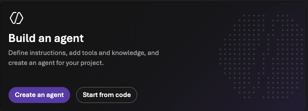
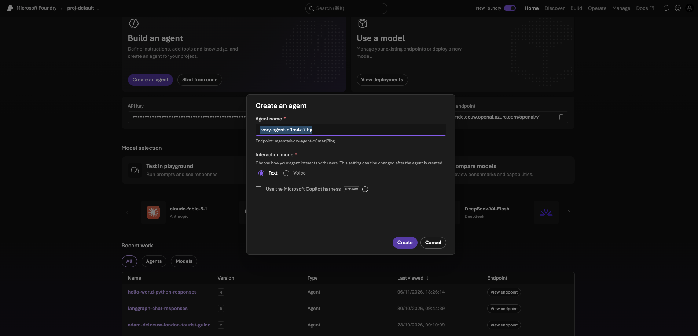
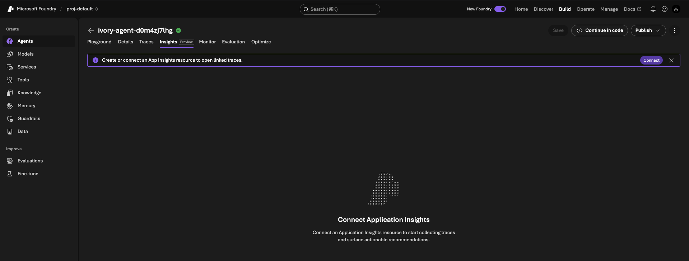
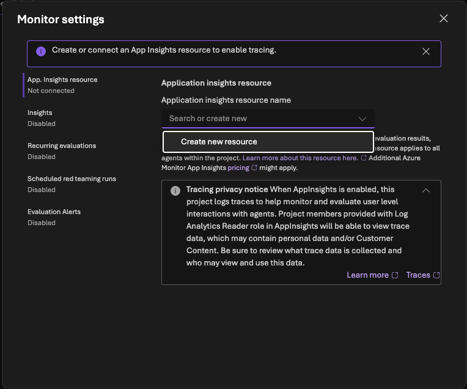
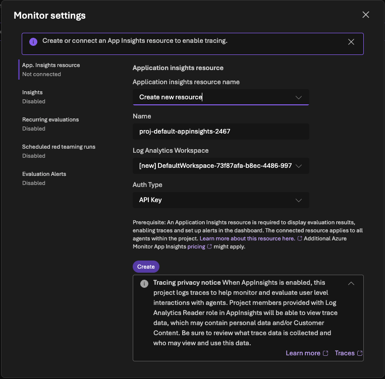
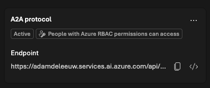
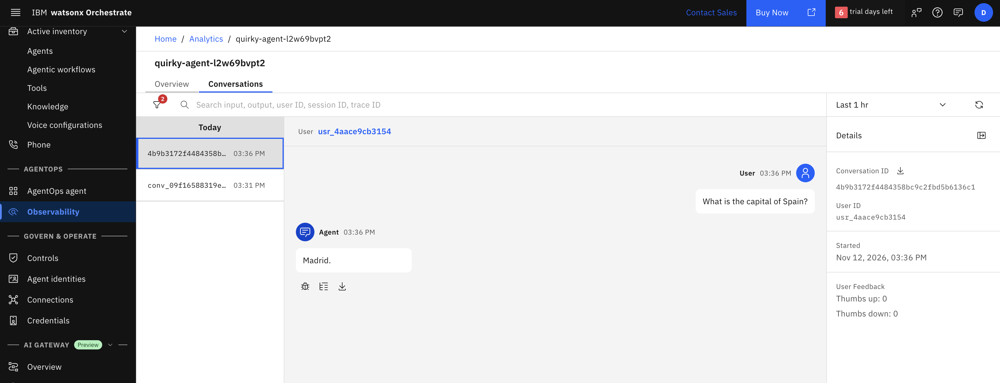

watsonx Orchestrate works as a control plane for agents. The control plane is the central layer where agents are registered, connected, governed and observed, wherever they run.

Azure Foundry agents can be defined with code or via a simple prompt. In a previous blog [watsonx Orchestrate Azure Agent Observability](https://deleeuw.me.uk/posts/watsonx-Orchestrate-azure-agent-observability/), I showed how a code-based agent can be configured to emit telemetry data to the watsonx Orchestrate control plane. In this sequel, the mechanism to capture telemetry data for a prompt based agent is demonstrated. This includes deploying a sample prompt agent, configuring Azure Insights Logging and using a Foundry App to periodically reads the logs and forward telemetry spans to the watsonx Orchestrate control plane.

This approach is only necessary when the messages are exchanged directly with the external agent, rather than via watsonx Orchestrate.

The [watsonx Orchestrate documentation](https://www.ibm.com/docs/en/watsonx/watson-orchestrate/base?topic=gateway-enabling-observability-external-agents) describes how to accomplish this observability for both hosted agents or prompt agents. 

## Define a simple prompt agent on Azure Foundry

In Azure Foundry, create a new agent by clicking 'Create an agent'.





Define some simple instructions for the agent, then enable Insights. You will be prompted to connect the Foundry project to an existing or new Log Analytics Workspace.







> Note, at this step I encountered an error "Setup incomplete: The project managed identity needs access to the Application Insights resource. We couldn't configure the project managed identity permissions. Ask an administrator to grant the required access, then check again". This was because the resource ID for my Foundry project had not been assigned roles Monitoring Metrics Publisher & Monitoring Reader.
{: .prompt-tip }

Optionally, enable A2A. This is not required for this use case where watsonx Orchestrate is simply observing the data.



## Register the external agent in watsonx Orchestrate

This can be done via the UI or the watsonx Orchestrate ADK CLI.

From the UI, use AI Gateway->Platforms to configure the connection to Azure. Then scan and register the external agent for observability. See [watsonx Orchestrate Azure Agent Observability](https://deleeuw.me.uk/posts/watsonx-Orchestrate-azure-agent-observability/) for details on this step.

Make a note of the external agent's ID.

## Enabling observability for the external agent

The [watsonx Orchestrate documentation](https://www.ibm.com/docs/en/watsonx/watson-orchestrate/base?topic=agents-integrating-tracing-azure-ai-foundry#azure-integration__configuring-tracing-for-kind-hosted-agents) provides a zip file which includes a `wire_agent.sh`.

The `wire_agent.sh` assumes the Azure func CLI is available. If necessary, install and verify it now.

```sh
npm install -g azure-functions-core-tools@4 --unsafe-perm true
func --version
```
> Note, it is not possible to install func using homebrew
{: .prompt-tip }

Prior to running the `wire_agent.sh` script, setup `config/azure.env` with the following variables.

```sh
export AZURE_SUBSCRIPTION_ID=""
export AZURE_RESOURCE_GROUP=""
export AZURE_LOCATION="eastus"
export LOG_ANALYTICS_WORKSPACE_ID=""
export LOG_ANALYTICS_WORKSPACE_NAME=""
# This name must be unique
export FUNCTION_APP_NAME="wxo-foundry-prompt-tracer-adamdeleeuw-11Nov"
export STORAGE_ACCOUNT_NAME="adamdeleeuw"
export WXO_TENANT_ID=""
export WXO_OTEL_EXPORT_URL="https://api.eu-west-2.dl.watson-orchestrate.ibm.com/instances/<instanceID>/v1/orchestrate/inject/traces"
export TOKEN_URL=https://account-iam.platform.saas.ibm.com/api/2.0/apikeys/token
export API_KEY=az..
export ENVIRONMENT_NAME="draft"   # or "live"
# This object maps one or more Azure agents to the Azure agent name
export WXO_AGENT_MAP='{
  "quirky-agent-l2w69bvpt2": {
    "agent_id": "<agentID>"
  }
}'
```
The WXO_OTEL_EXPORT_URL and TOKEN_URL are configured for watsonx Orchestrate running as SaaS on AWS.

Run command `wire_agent.sh --azure --prompt` (there is also a --dry-run flag). This performs the following steps:

- Creates or reuses the storage account.
- Creates or reuses a Function App. This triggers every 30 seconds and builds an OTLP span: input, output, token usage, tool calls where available, and timing. The data is sent to the 'WXO_OTEL_EXPORT_URL'
- Assigns the app a managed identity and gives it the Monitoring Reader role on the Log Analytics workspace.

> Note, if this is your first Function App, you may find the script fails with error "Cannot find ServerFarm with name EastUSLinuxDynamicPlan". If so, wait a few moments and run the script again.
{: .prompt-tip }

> Note, if like me you are using a corporate Azure account, your user id may have limited roles. Mine has only Contributor which allows creating and managing Azure resources. You may find that the `wire_agent.sh` script fails with error "Failed to query ... by invoking Graph API. Please specify --assignee-object-id and --assignee-principal-type.". This occurs when the script tries to query and adjust the roles that have been assigned to the newly defined Function App. If you encounter this scenario, you can skip this step by re-executing the command `./wire_agent.sh --azure --prompt --publish-only`. This proceeds to deploy the Function App code, although the Function app may still be missing the required role. The steps below will verify this.
{: .prompt-tip }

At this point, you will have a deployed Function App with an assigned Azure identity.

Verify the Function App triggers every 30 seconds and does not log any permission errors.

```sh
az monitor log-analytics query \
  --workspace <Log Analytics workspace ID> \
  --analytics-query "AppTraces | where Message has_any ('[poll]', '[LA]', '[cursor]', '[WXO]') | order by TimeGenerated desc | take 10 | project TimeGenerated, Message" \
  -o table
```

```sh
Message                                       TableName      TimeGenerated
--------------------------------------------  -------------  ----------------------------
[poll] 0 in window, 0 unseen                  PrimaryResult  2026-11-12T15:35:52.9622481Z
[LA] Token via Managed Identity               PrimaryResult  2026-11-12T15:35:52.9200245Z
[cursor] read: 2026-11-12T15:32:49.7121818Z   PrimaryResult  2026-11-12T15:35:52.9186291Z
[poll] timer fired | past_due=False | seen=0  PrimaryResult  2026-11-12T15:35:52.5869254Z
[poll] 0 in window, 0 unseen                  PrimaryResult  2026-11-12T15:35:42.7305256Z
[LA] Token via Managed Identity               PrimaryResult  2026-11-12T15:35:42.6920709Z
[cursor] read: 2026-11-12T15:32:49.7121818Z   PrimaryResult  2026-11-12T15:35:42.6909876Z
```

> Note, if the logs show InsufficientAccessError, the Function App's identity needs to be granted the Monitoring Reader role. Under normal circumstances the `wire_agent.sh` script would ensure this, unless the user id running the script had insufficient permissions to assign roles. I requested the following roles were added directly to my Function App: Monitoring Reader, Log Analytics Reader, Log Analytics Data Reader, Privileged Monitoring Data Reader
{: .prompt-tip }

## Testing the agent and observing the results with the watsonx Orchestrate control plane

Invoke the agent using curl with the responses or A2A endpoint. 

```sh
TOKEN=$(az account get-access-token --resource https://ai.azure.com/ --query accessToken -o tsv)

curl -X POST "https://adamdeleeuw.services.ai.azure.com/api/projects/proj-default/agents/quirky-agent-l2w69bvpt2/endpoint/protocols/openai/responses?api-version=v1" \
  -H "Authorization: Bearer $TOKEN" \
  -H "Content-Type: application/json" \
  -d '{"input": "What is the capital of Spain?"}'
```

From the external agent definition UI, select View Analytics.

Explore the telemetry captured from the external agent, including the recent conversation. You may need to wait 1-2 minutes for the data to arrive.

