watsonx Orchestrate works as a control plane for agents. The control plane is the central layer where agents are registered, connected, governed and observed, wherever they run.

Telemetry for external agents depends on how they are invoked. Requests routed through watsonx Orchestrate are automatically captured in its traces, whereas requests sent directly to the agent’s own endpoint bypass Orchestrate, requiring the agent or its hosting platform to emit the telemetry.

In the image below, the external agent is registered, and the application uses watsonx orchestrate API to invoke the agent. With this setup, watsonx orchestrate API automatically captures telemetry data. In addition, it's possible to control the agent response with policies, for example a policy to block PII can be added as a control to the agent.

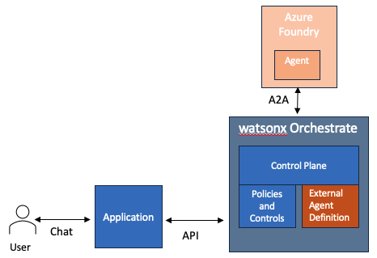

In the image below, the external agent is registered, but the application uses Azure API to invoke the agent. In this scenario the agent must be configured to emit telemetry data to the watsonx Orchestrate control plane.

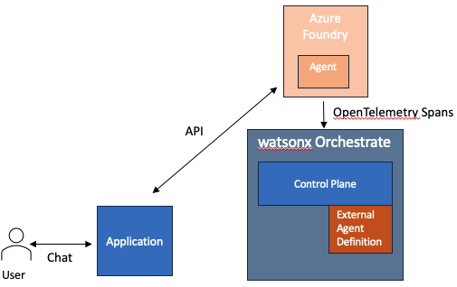

The [watsonx Orchestrate documentation](https://www.ibm.com/docs/en/watsonx/watson-orchestrate/base?topic=gateway-enabling-observability-external-agents) describes how to accomplish this for various agent hosting platforms. For Azure Foundry, there are different approaches for prompt agents or hosted agents. 

This blog shows how to deploy a sample agent, hosted in a container, to Azure Foundry and configure it to emit telemetry to the watsonx Orchestrate control plane.


## Deploy a sample hosted agent to Azure

In the Azure portal, create a Foundry instance and project. The screenshot below also shows a storage account and LogAnalytics workspace. This is not required for monitoring hosted agents, but would be required for prompt agents.

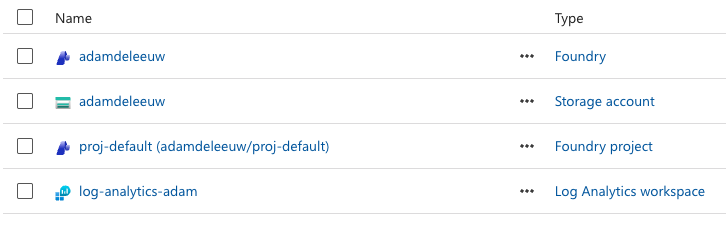


## Setup Azure Foundry

In [Azure Foundry](https://ai.azure.com/) find your API key. You should also make a deployment of the model you plan to use, e.g. gpt-5.

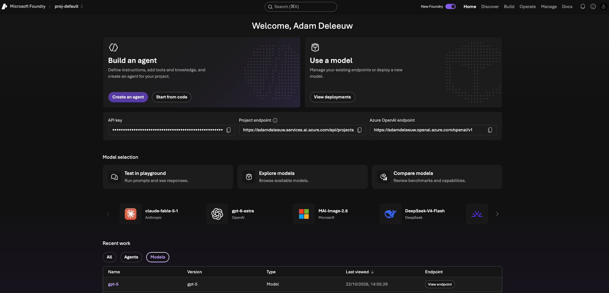

Click `Start from code` to get started with building an agent for your platform. Tip: if the `Build an Agent` button is greyed out, you will hit problems later even if starting from code. Therefore you need to ensure your Azure user has the appropriate [Foundry role](https://learn.microsoft.com/en-us/azure/foundry/concepts/rbac-foundry?tabs=owner%2Cfoundry#permissions-for-each-built-in-role). My user is assigned 'Foundry User' role.

I ran the following commands:

Install azd CLI.

```sh
brew install --cask microsoft/foundry/devpack && foundry-devpack install
```

Clone a Python sample agent. This uses the Foundry SDK to implement a custom agent.

```sh
azd ai agent init -m https://github.com/microsoft-foundry/foundry-samples/blob/main/samples/python/hosted-agents/bring-your-own/responses/hello-world/azure.yaml --project-id /subscriptions/<subID>/resourceGroups/<rgID>/providers/Microsoft.CognitiveServices/accounts/adamdeleeuw/projects/proj-default
```
Modify the sample agent to support the A2A protocol. This can be accomplished by editing the azure.yaml with the addition of the `agentEndpoint` and `agentCard` sections, or you can deploy first then enable A2A in the Foundry UI.

```yaml
# yaml-language-server: $schema=https://raw.githubusercontent.com/Azure/azure-dev/main/schemas/v1.0/azure.yaml.json

requiredVersions:
    azd: '>=1.27.1'
    extensions:
        azure.ai.agents: '>=1.0.0-beta.9'
name: hello-world-python-responses
services:
    ai-project:
        host: azure.ai.project
        deployments:
            - model:
                format: OpenAI
                name: gpt-5
                version: "2026-03-17"
              name: gpt-5
              sku:
                capacity: 10
                name: GlobalStandard
        endpoint: https://adamdeleeuw.services.ai.azure.com/api/projects/proj-default
    hello-world-python-responses:
        project: src/hello-world-python-responses
        host: azure.ai.agent
        language: python
        uses:
            - ai-project
        env:
            AZURE_AI_MODEL_DEPLOYMENT_NAME: ${AZURE_AI_MODEL_DEPLOYMENT_NAME}
            PYTHONNOUSERSITE: "1"
        codeConfiguration:
            entryPoint: main.py
            runtime: python_3_13
        container:
            resources:
                cpu: "0.5"
                memory: 1Gi
        description: Minimal Hello World agent using the Responses protocol with a bring-your-own approach. Calls a Foundry model via the Responses API and returns the response.
        displayName: Hello World (Python, Responses)
        kind: hosted
        metadata:
            tags:
                - AI Agent Hosting
                - Responses Protocol
                - Bring Your Own
                - Python
        name: hello-world-python-responses
        protocols:
            - protocol: responses
              version: 2.0.0
        agentEndpoint:
            versionSelector:
                versionSelectionRules:
                    - type: FixedRatio
                      agentVersion: "@latest"
                      trafficPercentage: 100
            protocols:
                - a2a
                - responses
            protocolConfiguration:
                responses: {}
                a2a: {}
            authorizationSchemes:
                - type: Entra
                  isolationKeySource:
                      kind: Entra
        agentCard:
            description: General-purpose assistant that answers questions concisely.
            version: 1.0.0
            skills:
                - id: general-qa
                  name: general-qa
                  description: Answers general questions concisely and informatively
                  tags:
                      - general
                      - qa
                  examples:
                      - What is the most popular car manufacturer in the USA?
infra:
    provider: microsoft.foundry

```

Deploy the agent.

```sh
azd auth login
azd deploy
```

Verify the agent has an A2A endpoint in the Foundry UI.

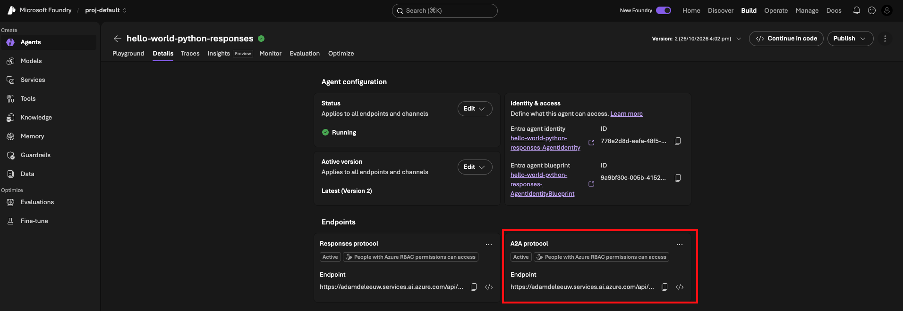

Use the A2A endpoint to test the agent with cURL.

```sh
TOKEN=$(az account get-access-token --resource https://ai.azure.com/ --query accessToken -o tsv)

curl -X POST "https://adamdeleeuw.services.ai.azure.com/api/projects/proj-default/agents/hello-world-python-responses/endpoint/protocols/openai/responses?api-version=v1" \
  -H "Authorization: Bearer $TOKEN" \
  -H "Content-Type: application/json" \
  -d '{"input": "What is the most popular car manufacturer in the USA?"}'
```

## Register the external agent in watsonx Orchestrate

This can be done via the UI or the watsonx Orchestrate ADK CLI.

From the UI, use AI Gateway->Platforms to configure the connection to Azure. Then scan and register the external agent.

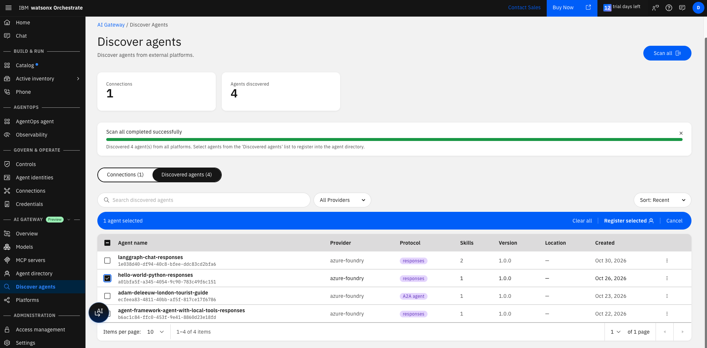

When importing the agent, you can choose 'Use and Observability' or 'Observability only'.

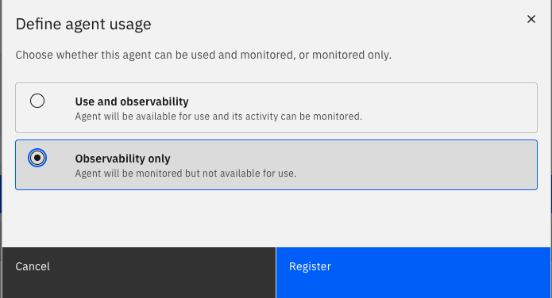

In our scenario, the agent will not be used directly via watsonx Orchestrate, so choose 'Observability only'. Note if you did want to chat directly with the agent using watsonx Orchestrate API, you would need to associate a Connection with the external agent.

Take note of the external agent's ID.

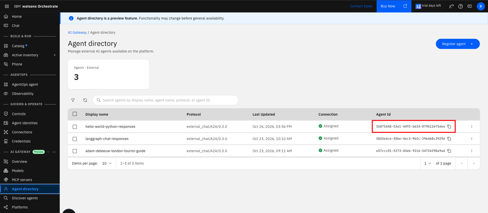

## Enabling observability for the external agents

With the assumption that the agent will be invoked directly and not via watsonx Orchestrate, it must be augmented to emit telemetry data.

The [documentation](https://www.ibm.com/docs/en/watsonx/watson-orchestrate/base?topic=agents-integrating-tracing-azure-ai-foundry#azure-integration__configuring-tracing-for-kind-hosted-agents) explains how to do this for a hosted agent.

The process involves downloading a zip file from the IBM documentation. It includes a `wire_agent.sh` script which repackages the existing agent code with a `sitecustomize.py` which patches the agents HTTP / RPC handler.

Prior to running the `wire_agent.sh` script, setup `config/azure.env` with the following variables.

```sh
export AZURE_SUBSCRIPTION_ID=""
export AZURE_RESOURCE_GROUP=""
export AZURE_LOCATION="eastus"
export AZURE_ACCOUNT="adamdeleeuw"
export AZURE_PROJECT="proj-default"
export AZURE_AGENT_NAME="hello-world-python-responses"
export WXO_TENANT_ID=""
export WXO_OTEL_EXPORT_URL="https://api.eu-west-2.dl.watson-orchestrate.ibm.com/instances/<instanceID>/v1/orchestrate/inject/traces"
export ENVIRONMENT_NAME="draft"   # or "live"
# Minimal form — single agent (tenant/url from globals above):
export WXO_AGENT_MAP='{
  "hello-world-python-responses": {
    "agent_id": "<agentID>"
  }
}'
export TOKEN_URL=https://account-iam.platform.saas.ibm.com/api/2.0/apikeys/token
export API_KEY=az....
export AZURE_AI_MODEL_DEPLOYMENT_NAME="gpt-5"
export AGENT_SOURCE_DIR="../hello-world-python-responses/src/hello-world-python-responses"
export WXO_AGENT_ID=f6875448-53e1-4493-b6f4-079b12675dea
export WXO_AGENT_NAME=hello-world-python-responses
```

The WXO_OTEL_EXPORT_URL and TOKEN_URL are configured for watsonx Orchestrate running as SaaS on AWS. Note the WXO_AGENT_ID and WXO_AGENT_NAME result from the external agent registration on watsonx Orchestrate in the previous section.

Run command `wire_agent.sh --azure` (there is also a --dry-run flag). This will repackage the agent, without changing its code, and deploy a new version to Azure Foundry.

## Testing the agent and observing via the watsonx Orchestrate control plane

Invoke the agent again.

```sh
TOKEN=$(az account get-access-token --resource https://ai.azure.com/ --query accessToken -o tsv)

curl -X POST "https://adamdeleeuw.services.ai.azure.com/api/projects/proj-default/agents/hello-world-python-responses/endpoint/protocols/openai/responses?api-version=v1" \
  -H "Authorization: Bearer $TOKEN" \
  -H "Content-Type: application/json" \
  -d '{"input": "What is the most popular pet?"}'
```

From the external agent definition UI, select View Analytics.

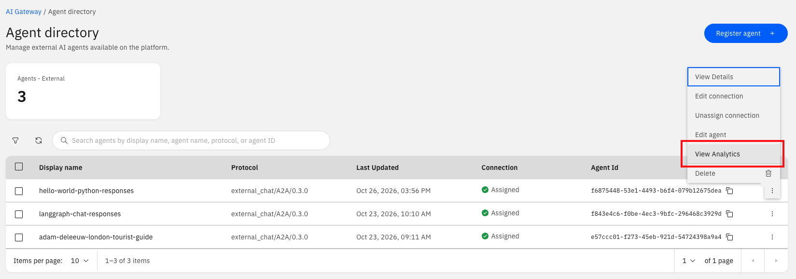

Explore the telemetry captured from the external agent, including the recent conversation. You may need to wait 1-2 minutes for the data to arrive.

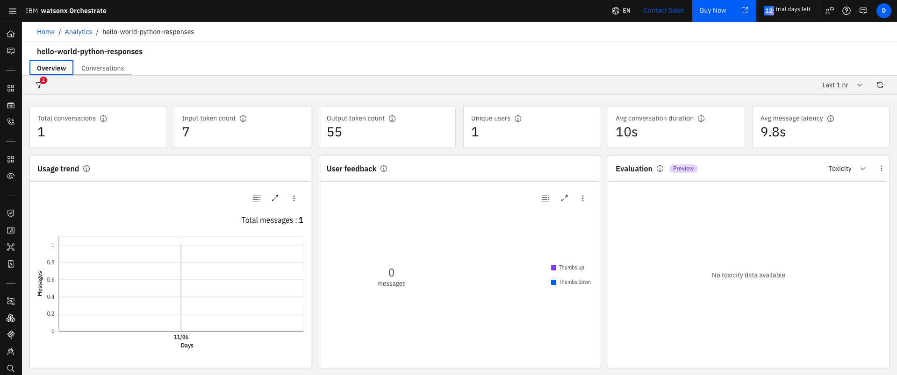

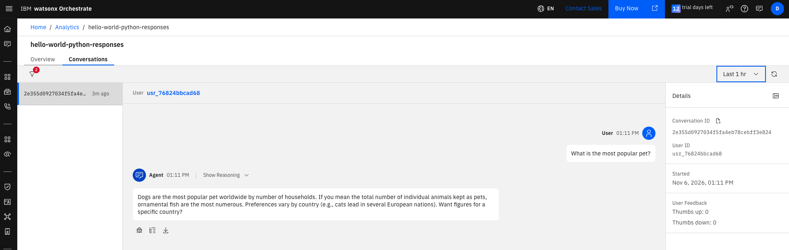

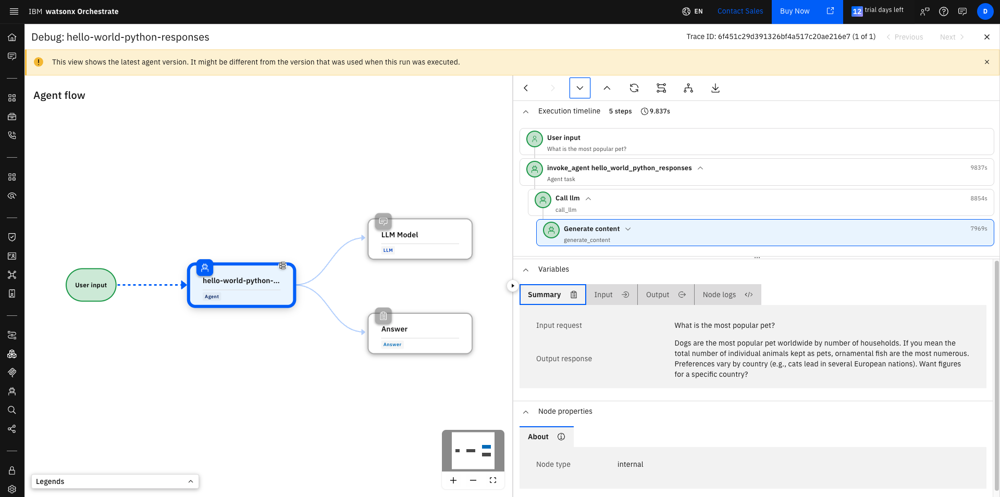
